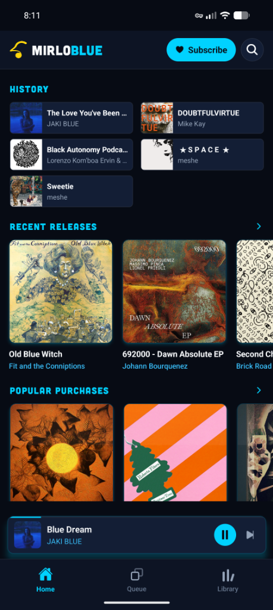

# MirloBlue

A music player for Mirlo, independent radio, podcasts, and your own files.



## Features

- Music from Mirlo's Chorus catalog, played in the app's native player.
- Independent radio from Radio-Browser and a curated station list.
- Podcasts from RSS feeds and the Castopod Index, plus curated shows.
- Downloads saved as standard audio files with embedded tags.
- Local music files, offline listening, and a customizable queue.
- No ads or tracking.

## Music sources

MirloBlue currently reads Mirlo's Chorus catalog at `/v1/sm/canimus.json`.

Other catalogs may be added when MirloBlue can play their audio directly and respect the artist's consent and access limits. Catalogs that require another platform's player are not included.

## Radio

Stations provide their own live streams, often through Icecast. MirloBlue combines curated stations with listings from [Radio-Browser](https://www.radio-browser.info/), and filters for working streams and suitable artwork.

## Podcasts

MirloBlue finds shows through the [Castopod Index](https://index.castopod.org/) and curated picks. Episodes play from the publisher's RSS feed.

## Quick Start

**Requirements:** Node.js 20 or later

```bash
npm install
```

Create `.env`:
```
EXPO_PUBLIC_API_ROOT=https://mirlo.space
EXPO_PUBLIC_API_KEY=
```

```bash
npm run web
```
Open `http://localhost:8081`.

## Installation

**Android:** Download the latest APK from [Releases](https://github.com/grendel116/mirlo-blue/releases).

To build from source:
```bash
npx eas-cli login
npx eas-cli build -p android --profile preview
```

## Tests

```bash
npm test
```

## Credits & License

Based on the [Mirlo mobile app](https://github.com/funmusicplace/mirlo-mobile). Support artists at [mirlo.space](https://mirlo.space).

Released under the **AGPL-3.0** license. See [LICENSE](LICENSE) and [License.md](License.md).
